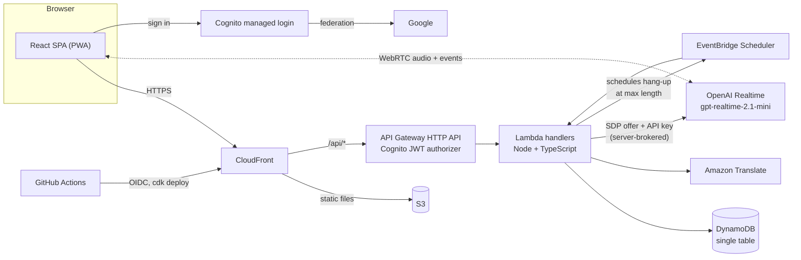

# Immersr

[](https://github.com/caolan-hamilton/immersr/actions/workflows/ci.yml)

Immersr is a language-immersion web app: you hold a live voice conversation with an AI Partner in European Portuguese, Castilian Spanish or French.
It uses crosstalk: the Partner speaks only the language you're learning and you reply in English, so you build listening comprehension without the pressure of speaking.

**Try it:** [dfjpuii0kx20s.cloudfront.net](https://dfjpuii0kx20s.cloudfront.net). Sign in with Google to get 15 minutes of conversation a day.

## Architecture



The browser never holds an OpenAI key. It sends its WebRTC offer to the API, which reserves the Session's minutes, builds the Partner's instructions on the server and forwards the offer to OpenAI. The audio then flows directly between the browser and OpenAI.

## Key decisions

- [0001](docs/adr/0001-openai-realtime-mini-over-webrtc.md): OpenAI `gpt-realtime-2.1-mini` over WebRTC as the voice provider, not Gemini Live or Nova Sonic
- [0002](docs/adr/0002-dynamodb-for-all-app-data.md): DynamoDB for all app data, not Aurora Serverless or RDS
- [0003](docs/adr/0003-google-only-sign-in.md): Google-only sign-in, so Google does the identity proofing
- [0004](docs/adr/0004-server-brokered-sessions-reserve-then-settle.md): Server-brokered Sessions with reserve-then-settle metering
- [0005](docs/adr/0005-openai-standard-api-without-eu-residency.md): OpenAI's standard API, not EU data residency, for the MVP
- [0006](docs/adr/0006-single-table-keyed-by-learner.md): One DynamoDB table keyed by Learner
- [0007](docs/adr/0007-account-erasure-may-reset-the-daily-allowance.md): Account erasure may reset the Daily allowance, which is an accepted gap

## How it's built

I built this with AI coding agents, using a spec-driven workflow. Each feature starts with a "grilling" session that settles its decisions, which become a spec, ADRs and [GLOSSARY.md](GLOSSARY.md). The spec is then split into tracer-bullet tickets, each a thin end-to-end slice with acceptance criteria. Claude, running in GitHub Actions, implements a ticket test-first and opens a pull request. A second Claude workflow reviews every PR against its ticket and hands "needs changes" findings back for a fix. I make the design decisions, review the PRs and decide what merges. Prod deploys from `main` through CI.

**Stack:** TypeScript · React 19 · Vite · Tailwind CSS · Node.js Lambda · API Gateway · DynamoDB · Cognito · CloudFront · AWS CDK · OpenAI Realtime (WebRTC) · Amazon Translate · Vitest · GitHub Actions

---

## For developers

Read [GLOSSARY.md](GLOSSARY.md) for the vocabulary and [docs/adr/](docs/adr/) for the decisions behind the design. The MVP spec is issue #1, and the UI pass is issue #34.

## Layout

| Path | What |
|---|---|
| `apps/web` | React + Vite single-page app |
| `apps/api` | Lambda handlers (Node/TypeScript), test harness |
| `packages/shared` | zod request/response schemas used by web and api |
| `infra` | AWS CDK app: `Immersr-prod`, `Immersr-dev-<you>`, `Immersr-ci` |
| `spikes/` | throwaway experiments (voice accent/drift test) |

## Develop

Requirements: Node 22 (`nvm use`), pnpm (`corepack enable pnpm`), and Docker for DynamoDB Local.

```sh
pnpm install
pnpm db:local        # start DynamoDB Local on :8000 (Docker)
pnpm test            # API tests through the API seam
pnpm typecheck
```

After changing the Partner's instructions, run the live drift check and the listening checklist ([docs/drift-check.md](docs/drift-check.md)). The check costs real money and isn't part of CI.

### Personal dev stack

Your own stage, deployed from your laptop (needs AWS credentials and the one-off bootstrap in [docs/setup/bootstrap.md](docs/setup/bootstrap.md)):

```sh
pnpm deploy:dev      # deploys your Immersr-dev-<you> stack and prints its Url
API_PROXY=<that Url> pnpm dev:web   # local Vite app talking to your dev API
```

## Deploy

`prod` deploys from GitHub Actions on every push to `main`: typecheck → tests (with DynamoDB Local) → `cdk synth` → `cdk diff` → deploy. It uses GitHub OIDC, so no AWS keys are stored. The one-off setup is in [docs/setup/bootstrap.md](docs/setup/bootstrap.md), and the spend limits and account protections are in [docs/setup/cost-protections.md](docs/setup/cost-protections.md).
